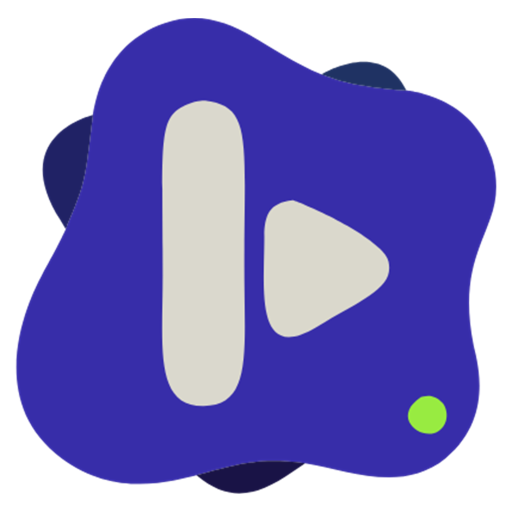

<p align="center">
  
</p>

<h1 align="center">Koda for Windows</h1>

<p align="center">
  <b>A native music player for Windows, powered by YouTube Music.</b>
</p>

<p align="center">
  <a href="https://github.com/Ivorisnoob/koda-windows/releases/latest"></a>
  
  
  
  
</p>

Koda is a family of apps: one native app per operating system, each built with that platform's own
design system. [Koda for Android](https://github.com/Ivorisnoob/Koda) and
[Koda for iOS and macOS](https://github.com/Ivorisnoob/iKoda) are its siblings; this repository is
the Windows one - WinUI 3, Fluent, Mica, and the Windows shell's own surfaces.

No official YouTube API key, no account, no ads in the app.

## Download

Get the latest release from the [releases page](https://github.com/Ivorisnoob/koda-windows/releases/latest).
Both downloads are for Windows 11 on x64 and carry everything they need.

| File | What it is |
|---|---|
| `Koda-<version>-win-x64.msi` | **The installer.** Double-click it: Koda lands in your own Programs folder with a Start menu entry. No administrator rights needed. Installing a newer version replaces the old one and keeps your library. |
| `Koda-<version>-win-x64-portable.zip` | **Portable.** Unzip anywhere and run `Koda.exe`. Nothing is installed or registered. |

The release is not code-signed, so SmartScreen may say the file is unrecognised: choose
**More info**, then **Run anyway**. There is no MSIX yet - that format needs a signing certificate
Windows already trusts.

## What's in it

**Listening**

- **Home**: Your Mix, Quick picks, recently played, your top artists, charts and YouTube Music's
  own shelves.
- **Search** for songs, albums, artists and playlists, with recent searches.
- **Album, artist, playlist and mood pages**, each with its own hero and track list.
- **Now Playing** in the cover's own colours, with the queue beside it.
- **Lyrics, word by word**, from YouLyPlus, BetterLyrics and LRCLIB at once: the line being sung
  fills as it is sung, backing vocals sit under their line, a duet's second voice takes the right.
  Right-click a line to share it as an image.
- **Crossfade** of 1 to 12 seconds (repeat one included), gapless changes with it off, and
  **volume normalization** to YouTube's loudness target.
- **The queue**: shuffle, repeat, Play next, drag to reorder, and Autoplay that carries on with the
  radio of the last song.
- **Sleep timer**, and skip back and ahead by 5, 10, 15 or 30 seconds.

**Your library**

- Liked songs, saved albums, playlists and artists, and playlists of your own.
- **Downloads**: a song from its right-click menu, or a whole album or playlist, to play without a
  connection. Songs you play all the way through are kept too, under Ready Offline.
- **History** of every play by the day, and **listening stats**.
- **Suggest less**: keep a song or an artist out of Home, mixes, radio and autoplay.
- **Back up and restore** the whole library as one file, and **import a Koda for Android backup**.

**Connected**

- **Last.fm** scrobbling, with your own API account and Last.fm's own approval page. Koda never sees
  your password, and plays made offline are sent later.
- **Discord**: show what you're playing on your profile, with the cover and a link to the song.

**Windows**

- Media keys and the Windows media card, the taskbar's progress and buttons, and a Jump List.
- Close to the tray and keep playing; a song notification while Koda is out of sight.
- A mini player that stays on top, a choice of audio output, open at login, `koda://` links and
  the Windows share sheet.
- Works from the keyboard and with a screen reader; follows the system theme, accent and Energy
  Saver.

See [CHANGELOG.md](CHANGELOG.md) for what changed in each release.

## Where your data lives

Settings, library, downloads and the listening cache live in your per-user local app data,
`%LOCALAPPDATA%\Koda`. Set `KODA_DATA` to keep them somewhere else, for example beside a portable
copy:

```powershell
$env:KODA_DATA = 'D:\KodaData'
```

A Last.fm sign-in is kept in the Windows Credential Manager on that PC, never in the data folder or
a backup.

## Building from source

You need Windows 11 (22H2 or newer) and the [.NET 10 SDK](https://dotnet.microsoft.com/download/dotnet/10.0).

```powershell
dotnet build src\Koda\Koda.csproj -p:Platform=x64
dotnet test tests\Koda.Core.Tests
```

The app is unpackaged and self-contained and runs straight from
`src\Koda\bin\x64\Debug\net10.0-windows10.0.26100.0\Koda.exe`.

The release artifacts - the portable zip, the MSI, and the MSIX when a signing certificate is
given - come from one script. The MSI is built with the [WiX Toolset](https://wixtoolset.org)
(`dotnet tool install --tool-path <path> wix --version 5.0.2`), from `installer/Koda.wxs`.

```powershell
.\scripts\build-release.ps1
.\scripts\build-release.ps1 -CertificateThumbprint <thumbprint>
```

## Repository layout

| Path | What it is |
|---|---|
| `src/Koda` | The WinUI 3 app: shell, pages, playback, lyrics, system integration. |
| `src/Koda.Core` | The engine: InnerTube client, parsers, audio transport and store, library, lyrics, downloads, Last.fm, Discord. |
| `tests/Koda.Core.Tests` | Offline tests, driven by recorded responses in `Fixtures`. |
| `installer` | The WiX project for the MSI. |
| `scripts` | The release build script. |

The engine talks to YouTube's InnerTube endpoints directly. Responses are recorded into fixtures
and the parsers are written against those, so the test suite runs offline and needs no account.

## License

GPL-3.0, like the rest of the family. See [LICENSE](LICENSE).

Koda is an independent project and is not affiliated with Google, YouTube, Last.fm or Discord.
